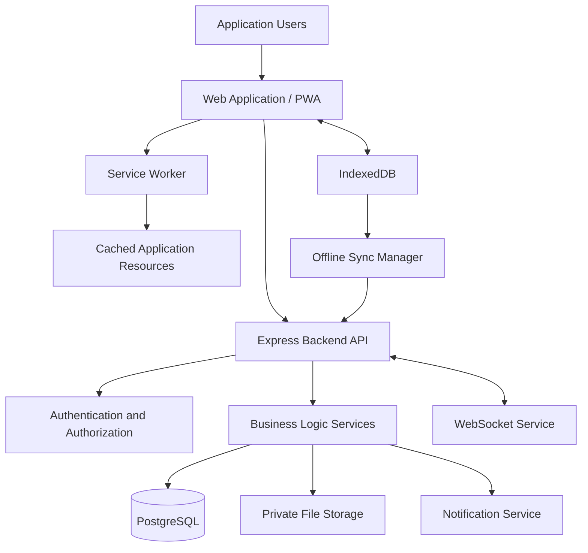

# Technical Architecture — ServiceDesk Clinic

## 1. Overview

ServiceDesk Clinic will follow a modular client-server architecture.

The application will provide a responsive web interface for clinic administrators, receptionists, doctors, and patients.

A centralized backend will manage business logic, authentication, authorization, appointment booking, queue operations, and medical records.

PostgreSQL will be used as the primary database.

The application will also support Progressive Web App (PWA) capabilities to allow essential front-desk operations during internet connectivity outages.

## 2. Technology Stack

| Layer | Technology | Responsibility |
|---|---|---|
| Frontend | HTML5 | Application structure |
| Styling | CSS3 | Responsive user interface |
| Frontend Logic | Vanilla JavaScript | Client-side interactions |
| Offline Application | PWA | Installable web application |
| Resource Caching | Service Worker | Cache application resources |
| Local Database | IndexedDB | Store permitted offline data |
| Backend | Node.js | JavaScript runtime |
| API Framework | Express.js | Backend API development |
| Main Database | PostgreSQL | Central application data |
| Real-Time Communication | WebSockets | Live queue updates |
| Authentication | Secure Server-Managed Sessions | User authentication |
| File Storage | Private Object Storage | Laboratory reports and attachments |
| Version Control | Git and GitHub | Source code management |
| Deployment | Cloud Hosting | Application hosting |

The exact hosting provider, notification provider, and object storage provider will be selected before deployment.

## 3. High-Level Architecture

The system consists of the following layers:

### 3.1 Presentation Layer
Provides interfaces for:
- Clinic administrators.
- Receptionists.
- Doctors.
- Patients.

Responsibilities:
- Display application data.
- Collect user input.
- Perform basic frontend validation.
- Communicate with backend APIs.
- Display queue and appointment updates.

### 3.2 Offline Application Layer
Provides essential front-desk functionality when internet connectivity is unavailable.

Responsibilities:
- Cache application resources.
- Store permitted offline records.
- Maintain pending synchronization operations.
- Detect connectivity changes.
- Synchronize pending operations when connectivity returns.

### 3.3 Backend Application Layer
Built using Node.js and Express.js.

Responsibilities:
- Authentication and authorization.
- Patient management.
- Doctor management.
- Schedule management.
- Appointment booking.
- Token allocation.
- Queue management.
- Medical records.
- Laboratory report management.
- Notification processing.
- Offline synchronization.

### 3.4 Data Layer
PostgreSQL will store centralized application data.

Responsibilities:
- Maintain relational data.
- Enforce database constraints.
- Support transactions.
- Preserve data consistency.
- Manage clinic-level data isolation.

### 3.5 Supporting Services
Additional services will support:
- Private document storage.
- SMS or other notifications.
- Application logging.
- Database backups.
- Monitoring.

## 4. Logical Architecture Diagram



## 5. Frontend Architecture

The frontend will initially use HTML, CSS, and vanilla JavaScript.

A modular frontend structure will be maintained to avoid placing the entire application logic in a single JavaScript file.

Proposed structure:

```text
frontend/
  index.html
  pages/
  assets/
    css/
    js/
      modules/
      services/
      utils/
  manifest.json
  service-worker.js
```

### Frontend Responsibilities

- Render user interfaces.
- Handle forms and user interactions.
- Validate user input before submission.
- Communicate with backend APIs.
- Manage permitted local offline data.
- Display synchronization status.
- Update queue information.

Frontend validation will improve usability but will not replace backend validation.

## 6. Backend Architecture

The backend will use a modular structure organized around business domains.

Proposed structure:

```text
backend/
  src/
    config/
    database/
    middleware/
    modules/
      auth/
      clinics/
      users/
      doctors/
      schedules/
      patients/
      appointments/
      queue/
      visits/
      prescriptions/
      lab-orders/
      lab-reports/
      follow-ups/
      notifications/
      synchronization/
    utils/
    app.js
    server.js
  tests/
```

### Backend Request Flow

A typical API request will follow this flow:

1. Client sends an HTTP request.
2. Express receives the request.
3. Authentication middleware verifies the session.
4. Authorization middleware checks permissions.
5. Controller validates request structure.
6. Service layer applies business rules.
7. Database layer executes the required query.
8. Backend returns an appropriate response.

### Example API Responsibilities

| Module | Example Endpoint |
|---|---|
| Authentication | POST /api/auth/login |
| Patients | POST /api/patients |
| Patients | GET /api/patients |
| Doctors | GET /api/doctors |
| Schedules | GET /api/doctors/:id/schedules |
| Appointments | POST /api/appointments |
| Appointments | GET /api/appointments |
| Queue | GET /api/doctors/:id/queue |
| Queue | POST /api/queue/call-next |
| Synchronization | POST /api/sync |

These are proposed API routes. Their final request and response structures will be defined during implementation.

## 7. Database Architecture

PostgreSQL will be used as the primary relational database.

### Initial Database Entities

| Table | Purpose |
|---|---|
| clinics | Clinic information |
| users | Authentication and user accounts |
| doctors | Doctor profiles |
| doctor_schedules | Doctor working schedules |
| patients | Patient information |
| appointments | Appointment bookings |
| queue_events | Queue activity history |
| visits | Consultation records |
| prescriptions | Prescription records |
| lab_orders | Laboratory test requests |
| lab_reports | Uploaded laboratory reports |
| follow_ups | Follow-up information |
| audit_logs | Important user activities |
| sync_operations | Offline synchronization tracking |

### Important Relationships

- One clinic can have multiple users.
- One clinic can have multiple doctors.
- One doctor can have multiple schedules.
- One patient can have multiple appointments.
- One doctor can have multiple appointments.
- One appointment can result in a consultation record.
- One patient can have multiple consultation records.
- One consultation can have multiple prescriptions and laboratory requests.

### Database Design Principles

- Use primary and foreign keys.
- Apply appropriate database constraints.
- Normalize relational data where appropriate.
- Use transactions for critical operations.
- Use indexes for frequently searched fields.
- Associate clinic-owned records with their clinic.
- Enforce tenant isolation in backend queries and authorization.

## 8. Offline Architecture

Offline support is an important requirement because some clinics may experience unreliable internet connectivity.

The initial implementation will support one designated front-desk device as the offline booking authority.

### 8.1 Service Worker

The Service Worker will cache the application shell and essential static resources.

This will allow the application interface to load when the internet is unavailable, provided it has previously been installed or loaded and cached.

### 8.2 IndexedDB

IndexedDB will store permitted offline information, including:

- Pending patient registrations.
- Offline walk-in booking operations.
- Local queue operations.
- Synchronization metadata.

Sensitive information will be minimized and protected.

### 8.3 Synchronization Process

1. Front desk performs an operation while offline.
2. The application stores the operation locally.
3. The operation receives a unique identifier.
4. The operation is marked as pending synchronization.
5. Connectivity returns.
6. The synchronization manager submits pending operations.
7. Backend validates each operation.
8. Backend safely stores accepted operations.
9. The client marks successful operations as synchronized.
10. Conflicting operations are flagged for review.

### 8.4 Synchronization Safety

The implementation will use:

- Unique operation identifiers.
- Idempotent API processing.
- Database transactions.
- Conflict detection.
- Explicit synchronization status.
- Retry handling.

The initial offline implementation will not guarantee online appointment availability during an outage.

Full multi-device offline synchronization is outside the initial scope.

## 9. Real-Time Queue Architecture

WebSockets will be used to communicate queue updates between connected devices.

Example:

1. Doctor calls the next patient.
2. Backend validates the action.
3. Backend updates the queue in PostgreSQL.
4. Backend publishes a queue update.
5. Connected receptionist and waiting-room screens receive the update.

The database remains the source of truth.

If a device disconnects, it should retrieve the latest authorized queue state after reconnecting.

## 10. Authentication and Security Architecture

Security will be implemented at both application and database levels.

### Authentication
- Secure password hashing.
- Server-managed sessions.
- Secure session cookies.
- Session expiration and invalidation.

### Authorization
- Role-based access control.
- Clinic-level data isolation.
- Server-side permission checks.
- Doctor-specific access restrictions where required.

### API Security
- Server-side input validation.
- Parameterized database queries.
- CSRF protection for cookie-authenticated requests.
- Appropriate rate limiting.
- HTTPS in production.

### Medical Data Security
- Private laboratory report storage.
- Authorized document access.
- Audit logging.
- Minimal local offline data.
- Appropriate backup and recovery controls.

### Public Display
The public waiting-room display will show token numbers only and must not expose patient names or medical details.

## 11. File Storage Architecture

Laboratory reports and other private documents will be stored separately from the main relational database using private object storage.

The database will maintain metadata such as:

- Patient reference.
- Laboratory request reference.
- Storage object identifier.
- File type.
- Upload timestamp.
- Uploader reference.
- Review status.

Files must be accessed through authorized backend operations or short-lived protected access mechanisms.

Public permanent file URLs will not be used for medical documents.

## 12. Deployment Architecture

The production deployment is expected to contain:

- Frontend web application.
- Node.js and Express backend.
- PostgreSQL database.
- Private file storage.
- Notification integration.
- HTTPS configuration.
- Logging and monitoring.
- Database backups.

Development, testing, and production environments should be separated.

Sensitive environment variables must not be committed to GitHub.

## 13. Testing Strategy

The project will include:

### Unit Testing
Testing individual functions and business rules.

### Integration Testing
Testing interactions between API endpoints and the database.

### API Testing
Testing authentication, validation, permissions, and error handling.

### Offline Testing
Testing:
- Application loading without internet.
- Offline patient registration.
- Local token allocation.
- Pending synchronization.
- Duplicate prevention.
- Conflict handling.

### User Acceptance Testing
Testing real clinic workflows with representative receptionist and doctor scenarios using synthetic data.

## 14. Scalability and Future Improvements

The architecture should allow future additions without major redesign.

Potential improvements include:

- Multi-clinic SaaS support.
- Advanced reporting.
- Financial management.
- SMS and WhatsApp integrations.
- More advanced offline capabilities.
- Mobile applications.
- External laboratory integrations.

## 15. Architecture Principles

The following principles will guide implementation:

1. Keep the architecture modular and understandable.
2. Enforce business rules on the backend.
3. Treat PostgreSQL as the centralized source of truth.
4. Protect patient information at every layer.
5. Design offline functionality with data consistency in mind.
6. Use transactions for critical database operations.
7. Keep frontend and backend responsibilities separate.
8. Build incrementally and test each module.
9. Avoid unnecessary complexity in the initial release.

---

**Document Status:** Proposed technical architecture for the initial development phase.